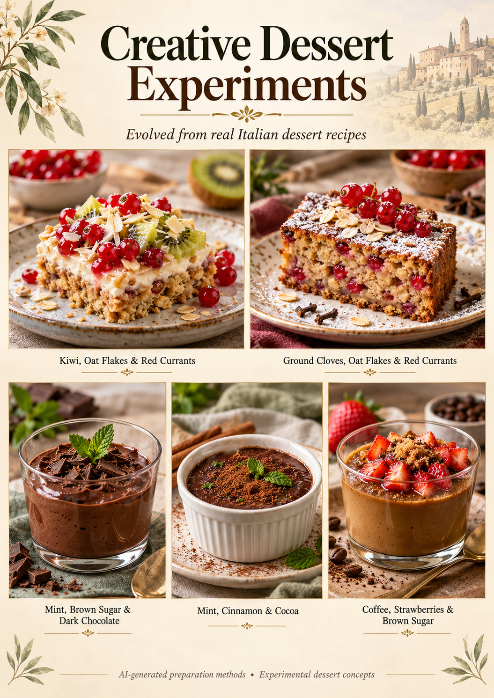

# The Great Bitwise Bake Off

**Can an evolutionary algorithm invent a dessert worth making?**

A computational creativity project by **Sunil Parameswaran, Tarik Začiragić, and Tommaso Zocche** at Leiden University. The system learns an ingredient co-occurrence network from Italian desserts, evolves new ingredient combinations, and uses an LLM to assess and explain selected recipes.

[Get started](#quick-start) · [Promising desserts](cookbook/promising.md) · [Creative experiments](cookbook/creative.md) · [Project report](docs/project-report.pdf) · [Setup details](docs/SETUP.md)



*AI-generated presentation artwork, not photographs of cooked recipes. The report documents visual embellishments and ingredients absent from the actual recipes. The ingredient lists, not these illustrations, define the generated artifacts.*

## From recipes to new recipes

```text
Italian dessert corpus (Dolci)
          ↓
Clean names and estimate quantities
          ↓
Recipe–ingredient bipartite graph
          ↓
Weighted ingredient co-occurrence network
          ↓
Size-controlled Leiden communities
          ↓
Evolution: conservative / balanced / experimental
          ↓
Fixed ingredient sets + sampled quantities
          ↓
LLM judging → diverse finalists → English preparation methods
          ↓
Two cookbooks: Promising Desserts & Creative Dessert Experiments
```

The evolutionary algorithm generates the ingredient sets **before** the LLM is called. It has no hand-written ingredient-role taxonomy. The LLM judges fixed candidates without seeing profile or graph fitness, then writes methods for the selected finalists. It is not the evolutionary fitness function and does not participate in the search loop.

## What the project found

The submitted report describes **1,742 dessert recipes**, **646 ingredients**, and **13,873 weighted ingredient–ingredient edges**. The report gives 2,388 bipartite nodes and 16,254 edges. A fresh verification found 2,390 nodes because the graph builder retains two empty recipe rows; evolution excludes them. See [verification notes](docs/RESULTS.md#publication-verification).

Three profiles trade familiarity for novelty. Each uses five seeds and contributes 20 candidates:

| Profile | Mean graph fitness | Mean novelty | Mean compatibility | Dessert-core coverage |
|---|---:|---:|---:|---:|
| Conservative | 0.752 | 0.39 | 0.48 | 85% |
| Balanced | 0.730 | 0.66 | 0.20 | 10% |
| Experimental | 0.769 | 0.84 | 0.03 | 0% |

These are **historical report values**, not newly measured results. Fitness uses different weights for each profile and must not be compared as a shared quality scale. “Core” is the report's post-hoc check for a sugar, a starch, and an egg or fat; it is not an implemented fitness term.

**The central finding:** greater novelty came with weaker familiar dessert structure. Co-occurrence captures what ingredients appear together, but does not establish workable ratios, cooking behavior, or taste. Independently sampled quantities were a major limitation.

### Example finalists

| Candidate | Collection | Ingredients highlighted in title | Potential / 10 | Creativity / 10 |
|---|---|---|---:|---:|
| C12 | Promising | Vanilla pod, cream, icing sugar | 8 | 2 |
| C08 | Promising | Milk, cream, butter | 8 | 1 |
| E04 | Promising | Red currants, nutmeg, hazelnut flour | 7 | 5 |
| E14 | Creative | Kiwi, oats, red currants | 7 | 6 |
| E09 | Creative | Cloves, oats, red currants | 6 | 5 |

The supplied Markdown cookbooks contain **five recipes each**, with no shared candidates. Scores are subjective LLM estimates, not human tasting results. None of the recipes has been cooked or tasted as part of the reported evaluation.

[Read the findings and limitations →](docs/RESULTS.md)

## Quick start

The graph pipeline and evolutionary search run locally with **Python 3.10+** and **igraph 1.0.0**. No GPU, model download, API key, or LLM server is needed to generate candidate ingredient sets.

```bash
git clone https://github.com/SunilParameswaran/Bitwise-Bakeoff.git
cd Bitwise-Bakeoff
python3 -m venv .venv
source .venv/bin/activate
python -m pip install -r requirements.txt

python net_pipeline/1_prepare_dataset.py
python net_pipeline/2_build_bipartite_graph.py
python net_pipeline/3_project_ingredients.py
python net_pipeline/4_run_leiden.py
python -m src.main --prepare-only
```

On Windows PowerShell, activate with `.venv\Scripts\Activate.ps1`. Run the commands from the repository root, in order. The first command downloads the source CSV if absent; later stages use the local files.

`--prepare-only` runs 15 searches and creates **60 candidates** in `results/candidates.json`. It stops before judging or writing cookbook methods. Exact runtime depends on the machine and graph.

### Optional: generate new complete cookbooks

An **external compatible chat-completions server** is required for judging and method generation:

```bash
python -m src.main \
  --base-url http://127.0.0.1:10531/v1 \
  --model YOUR_SERVER_MODEL_ID
```

Replace `YOUR_SERVER_MODEL_ID` with a model exposed by your server. The original environment used the label `gpt-5.6-terra`; this is a recorded server configuration, not a guarantee that the model is available from a public API. The repository does not launch a server or bundle model weights.

The current client sends JSON to `/chat/completions` without an Authorization header. Use a compatible local endpoint or a trusted proxy that handles authentication; simply pointing it at an authenticated service is insufficient. See [the API contract and cache behavior](docs/SETUP.md).

New generation overwrites `cookbook/creative.md` and `cookbook/promising.md`. Make a copy if you want to retain the supplied historical recipes. **`--fresh` deletes both `results/` and `cookbook/` before regeneration**, including when combined with `--prepare-only`.

## How the creative search works

| Setting | Default |
|---|---|
| Population / elites / tournament | 60 / 3 / 3 |
| Maximum generations / stagnation patience | 100 / 15 |
| Mutation probability / cross-community rate | 0.45 / 0.12 |
| Ingredient count | 5–10; ideal range 6–9 |
| Seeds per profile | 1, 7, 21, 42, 99 |
| Candidates per profile / requested finalists per book | 20 / 5 |
| Minimum judged potential | 5 out of 10 |
| Known-mass batch | 500 g; unspecified amounts additional |

- **Crossover** preserves ingredients from shared learned communities and mixes parental ingredients.
- **Mutation** replaces, adds, or removes ingredients, usually within a community, sometimes crossing communities.
- **Fitness** combines connectivity, cosine compatibility, distance from source recipes, community diversity, length, and quantity support, with a rare-ingredient penalty.
- **Quantities** are sampled independently from ingredient distributions and renormalized after evolution. They are not jointly optimized.
- **Curation** alternates between two rankings, enforces disjoint collections and within-book diversity, and can return fewer finalists rather than silently lowering the potential threshold.

## Explore the project

```text
src/                  Evolution, fitness, quantity generation, LLM curation
net_pipeline/         Four ordered preprocessing and graph scripts
cookbook/             Two historical English recipe collections
docs/                 Setup, results, report, and presentation artwork
data/                 Downloaded/cleaned recipes (generated, ignored)
output/               Graph pickles and Gephi node/edge CSVs (generated, ignored)
results/              Candidate pools, judgments, selections, API traces (generated, ignored)
```

The provided code generates Markdown cookbooks, not the styled PDF cookbooks mentioned in the earlier project discussion. Those two cookbook PDFs were not present in the supplied folder; the original four-page project report is included.

## Evaluating creativity

The implemented evaluation uses graph-based proxies plus LLM potential/creativity scores. The later project discussion proposed a **Lovelace 2.0-style human constraint challenge** as future work. No such human evaluation was run or implemented here. [Evaluation scope and proposed follow-up](docs/RESULTS.md#future-human-evaluation).

## Verification

The complete no-LLM pipeline was run successfully on 31 October 2026: 33 communities, 15 evolutionary runs, and 60 distinct candidates. All five offline tests passed. [Environment, hashes, and checks](docs/validation.json). Judging and method generation were not rerun.

## Credits and data

Project authors: **Sunil Parameswaran, Tarik Začiragić, Tommaso Zocche**. Source recipes: [KanuSaru/italian-recipes](https://huggingface.co/datasets/KanuSaru/italian-recipes), derived from GialloZafferano. The project report contains the academic references and generative-AI disclosure.

The supplied project had no software license; this publication does not assign one on behalf of the team. Source-dataset terms are separate. Raw recipe data and runtime API logs are not committed.
